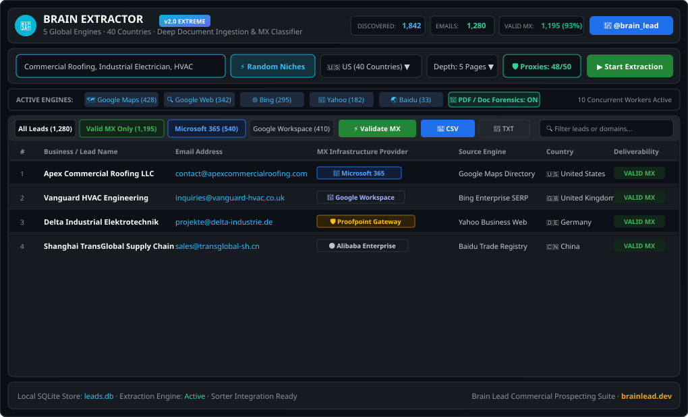

# Google Map Extractor (GME) — v3.0.0

> **AI-Powered Google Maps Business Lead Extractor & Autonomous Prospecting Co-Pilot**  
> *Developed & Maintained by [Brain Lead](https://brainlead.dev)*

[-orange.svg?style=flat-square)](https://brainlead.dev)

---

## ⚡ Overview

📍 AI-powered Google Maps business data extractor with built-in BYOK AI Autopilot (Gemini, Claude, OpenAI, Ollama), polygon area scanning, deep website tech stack auditing, and automated custom cold outreach pitch generation.

Built for marketing agencies, B2B sales teams, web/app developers, and local lead generation specialists, **Google Map Extractor v3.0.0** pairs ultra-fast local Google Maps extraction with an autonomous **AI Co-Pilot & Autopilot** that audits every prospect's digital footprint and crafts tailored cold outreach pitches automatically.

Compiled directly into native C/C++ machine code and digitally signed with Authenticode, GCE/GME runs locally on your Windows desktop with zero recurring per-query API platform fees.

---

## 🖥️ User Interface Preview

---

## 🚀 Core Operational Capabilities

### 1. 🤖 Autonomous AI Co-Pilot & Autopilot (BYOK)
Bring your own API key (or run 100% offline with Ollama) to turn raw map scrapes into qualified sales pipelines:
- **Multi-Provider Support**:
  - **Google Gemini**: Gemini 2.5 Flash, 2.5 Flash-Lite, 2.5 Pro, 3.0 Flash.
  - **Anthropic Claude**: Claude 3.5 Sonnet, 3.5 Haiku, 3 Opus (with prompt caching).
  - **OpenAI**: GPT-4o, GPT-4o-mini, o1, o3-mini (reasoning-aware token budgeting).
  - **Local Ollama**: Run private local LLMs (`llama3`, `mistral`, `qwen2.5`, `deepseek-r1`) completely offline.
- **Autonomous Agent Mission Loop**: Give plain-English instructions (e.g. *"Find 15 independent local restaurants with high reviews and broken/missing websites"*) and watch the AI plan multi-niche searches, inspect websites, read customer reviews, filter chains, and rank top leads.
- **AI Lead Scoring & Technical Audits**: Scores leads by revenue signals, digital pain points, missing SSL, absent mobile viewports, or slow/broken web presence.
- **Automated Cold Pitch Generation**: Generates personalized email subjects, icebreakers, and call openers tailored to each prospect's exact weaknesses.
- **Full Audit Logs & Memory**: Real-time action trace inspector, resumable missions, and rich Markdown/table previews.

### 2. 🗺️ High-Density Polygon Area Scan & Extraction
- **Interactive Polygon Mapping**: Draw custom areas directly on the map and subdivide cities, counties, and districts into dense grids so zero local businesses are skipped.
- **Direct Contact & Social Enrichment**: Crawls target websites in parallel to extract verified email addresses, phone lines, hours, and social profiles (Instagram, Facebook, LinkedIn, X/Twitter, YouTube).
- **Proxy Pool & Cookie Rotation**: Built-in HTTP/HTTPS/SOCKS proxy rotation and automated session management.

### 3. 📊 Adaptive Dual-Pane Workspace & Multi-Format Exports
- **Interactive Workspace**: Collapsible navigation, expandable split-screen AI Co-Pilot & results table, and saved shortlists.
- **Instant CRM Exports**: Export enriched leads and AI outreach campaigns directly to **CSV**, **Excel (`.xlsx`)**, **JSON**, and CRM-ready formats.

---

## 🆓 Free Trial Tier vs. Licensed (Full Version)

| Feature | Free Evaluation Tier | Licensed (Full Version) |
|---|---|---|
| **Results Per Search** | Capped at 50 leads | **Unlimited** |
| **Area Scan Tiles** | Max 4 tiles | **Unlimited** |
| **AI Co-Pilot & Autopilot** | Enabled (BYOK) | **Unlimited** |
| **Website & Contact Enrichment** | Enabled | **Unlimited** |
| **Multi-Format Exports** | Capped by 50 limit | **Unlimited CSV / XLSX / JSON** |
| **Self-Service Hardware Reset** | — | **Included** |

---

## 📦 Step-by-Step Quick Start Guide

1. **Download Release**: Download **`Google_Map_Extractor_v3.0.zip`** from the **[Releases](../../releases)** section (or clone/download `Google_Map_Extractor.exe` directly).
2. **Extract Files**: Extract the archive to a clean folder on your Windows PC (e.g. `C:\Tools\Google_Map_Extractor`).
3. **Install Certificate (One-Time Setup)**: Right-click **`Trust_Certificate.bat`** and select **Run as administrator** to register Brain Lead's Authenticode certificate into your Windows Trusted Store.
4. **Launch Application**: Double-click **`Google_Map_Extractor.exe`**. Your default browser will open automatically to the local web dashboard.
5. **Connect AI (Optional)**: Open **Settings → AI Engine**, paste your Gemini, Claude, OpenAI, or Ollama endpoint, and test connection to activate the AI Autopilot.
6. **Start Extracting**: Run keyword or polygon area scans, inspect enriched leads, or launch an AI Prospecting Mission.

---

## 🛒 Commercial Licensing & Upgrades

To activate unlimited leads, full polygon area scans, and priority support:

- 🤖 **Automated Telegram Bot**: [https://t.me/BrainLeadBot](https://t.me/BrainLeadBot)
- 💬 **Direct Support & Custom Scripts**: [https://t.me/brain_lead](https://t.me/brain_lead)
- 🌐 **Official Website**: [https://brainlead.dev](https://brainlead.dev)

---

## ⚖️ Legal Disclaimer & Terms of Use

1. **Intended Use**: This software is engineered strictly for authorized business intelligence, B2B market research, and CRM lead enrichment.
2. **Compliance**: Users are solely responsible for ensuring that all data collection and outreach activities comply with applicable local, national, and international laws, including CAN-SPAM, TCPA, GDPR, and relevant platform terms.
3. **Trademark Notice**: All third-party trademarks, logos, and company names referenced herein remain the exclusive property of their respective owners.
4. **Warranty & Liability**: The software is provided "as is", without warranty of any kind. In no event shall the authors or Brain Lead be held liable for any claim or damages arising from the use or misuse of this software.

---

### Discovery Tags
`#google-maps-extractor #google-maps-scraper #ai-lead-generation #b2b-leads #lead-generation #cold-outreach #sales-prospecting #email-scraper #phone-extractor #ai-autopilot #gemini-api #claude-ai #openai #ollama #windows-desktop #native-cpp`
